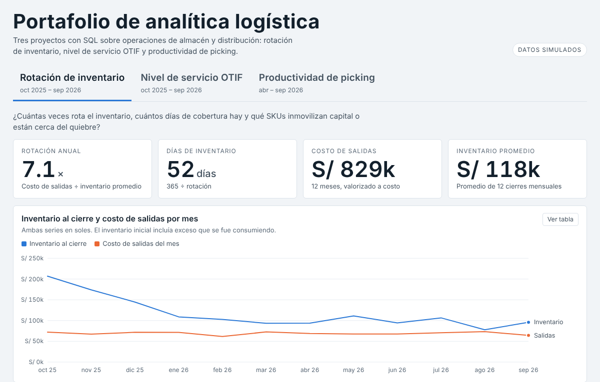
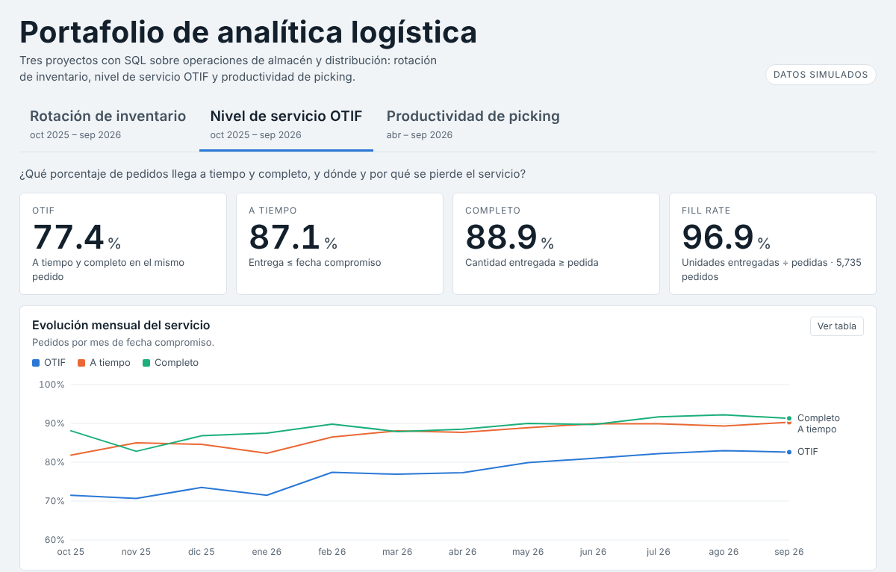
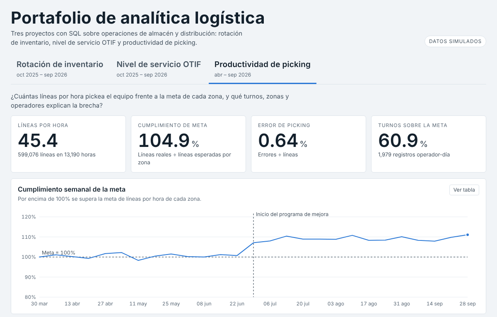

# Portafolio de analítica logística

Tres proyectos con SQL (SQLite) sobre operaciones de almacén y distribución, con datos **simulados** que incluyen errores de calidad a propósito.

| Proyecto | Pregunta | Carpeta |
|---|---|---|
| 1. Rotación de inventario | ¿Cuántas veces rota y qué SKUs inmovilizan capital? | `p1_rotacion_inventario/` |
| 2. Nivel de servicio OTIF | ¿Cuánto llega a tiempo y completo, y por qué falla? | `p2_otif/` |
| 3. Productividad de picking | ¿Cómo rinde el equipo frente a la meta? | `p3_productividad/` |

Cada carpeta tiene `data/` (CSV crudos), `sql/` (diagnóstico, limpieza y KPIs), `output/` (tablas listas para Power BI), `run.py`, `generar_datos.py` y un `README.md` con definiciones, resultados y medidas DAX.

## Flujo de trabajo de cada proyecto
1. Diagnosticar la calidad de los datos con consultas de conteo.
2. Limpiar con reglas explícitas y documentadas.
3. Calcular KPIs con SQL (CTE, funciones de ventana, agregaciones ponderadas).
4. Exportar a CSV para el modelo de Power BI.
5. Verificar con un recálculo independiente (`verificar_pandas.py`).

## Archivos de la raíz
- `dashboard.html`: tablero con los tres proyectos 
- `verificar_pandas.py`: recalcula los KPIs globales con pandas desde los CSV crudos y los compara con SQL.
- `build_dashboard.py`: regenera el tablero desde `output/`.

## Cómo presentarlo
- Declara que los datos son simulados. 
- Proyecto: análisis de rotación de inventario con SQL y Power BI (datos simulados); limpieza de 5 tipos de error, clasificación ABC y detección de 10 SKUs con más de 90 días de cobertura.

## Vista previa de los tableros

| Rotación de inventario | Nivel de servicio OTIF | Productividad de picking |
|---|---|---|
|  |  |  |
