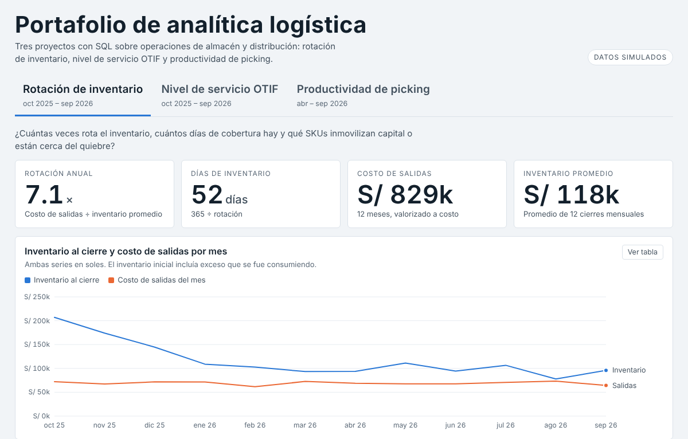

# Proyecto 1 · Rotación de inventario



> Datos **simulados** (no provienen de ninguna empresa). Se generaron con errores de calidad a propósito para practicar limpieza.

## Pregunta de negocio
¿Cuántas veces rota el inventario, cuántos días de cobertura hay y qué SKUs inmovilizan capital o están cerca del quiebre?

## Datos
| Archivo | Contenido |
|---|---|
| `data/productos.csv` | 60 SKUs: categoría, costo unitario, stock inicial |
| `data/movimientos.csv` | Entradas y salidas de 12 meses (oct 2025 – sep 2026) en 2 almacenes |

## Limpieza (SQL, `sql/00_diagnostico.sql` y `sql/01_limpieza.sql`)
Primero se mide cada problema y después se corrige.

| Problema | Filas | Tratamiento |
|---|---|---|
| Filas totales en bruto | 5444 | Referencia |
| id_mov duplicado (filas sobrantes) | 35 | Se conserva la primera aparición |
| Cantidad nula o vacía | 25 | Se excluye: no se puede inferir la cantidad |
| Cantidad negativa | 15 | Se toma el valor absoluto (error de signo; el tipo ya indica ENTRADA/SALIDA) |
| Fecha en formato dd/mm/yyyy | 120 | Se convierte a yyyy-mm-dd |
| SKU con espacios o minúsculas | 40 | TRIM + UPPER |
| SKU sin match en maestro | 0 | Se excluiría (0 esperado) |
| Filas finales en mov_limpio | 5384 | Base para los KPIs |

## Métricas (`sql/02_kpis.sql`)
- **Costo de salidas** = unidades de salida × costo unitario.
- **Inventario promedio** = promedio de los 12 stocks de cierre mensual × costo. Stock de cierre = stock inicial + acumulado (entradas − salidas), calculado con una función de ventana.
- **Rotación** = costo de salidas anual ÷ inventario promedio. **Días de inventario** = 365 ÷ rotación.
- **ABC** por costo de salidas acumulado: A hasta 80%, B hasta 95%, C el resto.
- **Estado**: riesgo de quiebre (< 30 días), saludable (30 a 90), alto (91 a 180), exceso (> 180) y revisar (stock negativo en algún cierre).

## Resultados
- Rotación global de **7.1×**, equivalente a **52 días** de inventario. Costo de salidas S/ 828,725 e inventario promedio S/ 117,502.
- Los **25 SKUs clase A** concentran el 80% del costo de salidas.
- **10 SKUs superan 90 días** de cobertura y mantienen S/ 17,967 en inventario promedio (15% del total).
- Categoría con rotación más lenta: **Snacks** (62 días).
- 1 SKU con stock negativo en algún cierre. Es un efecto de las filas excluidas por cantidad vacía y habría que auditar esos movimientos.

## Cómo reproducirlo
```bash
python3 generar_datos.py   # opcional: regenera los CSV crudos
python3 run.py             # carga a SQLite, ejecuta los .sql y exporta output/*.csv
```
También puedes abrir `output/proyecto.db` con DB Browser for SQLite y ejecutar los `.sql` uno por uno.

## Power BI
Importa de `output/`: `kpi_sku.csv`, `kpi_mensual.csv`, `kpi_categoria.csv`, `stock_mensual.csv`.

```dax
Costo Salidas = SUM ( kpi_sku[cogs] )
Inventario Promedio = SUM ( kpi_sku[inv_prom_valor] )
Rotación = DIVIDE ( [Costo Salidas], [Inventario Promedio] )
Días de Inventario = DIVIDE ( 365, [Rotación] )
SKUs Alto o Exceso = CALCULATE ( COUNTROWS ( kpi_sku ), kpi_sku[dias_inventario] > 90 )
```
Visuales sugeridos: 4 tarjetas (los KPIs), líneas con `kpi_mensual` (inventario al cierre y costo de salidas), barras de días de inventario por categoría, columnas por clase ABC y una tabla de SKUs filtrada por estado. Segmentadores: categoría y clase ABC.

## Limitaciones
- El inventario inicial simulado contiene exceso que se consume durante el año, por eso el valor al cierre baja en los primeros meses.
- La rotación usa salidas valorizadas a costo; con ventas reales se complementaría con margen y nivel de servicio.
