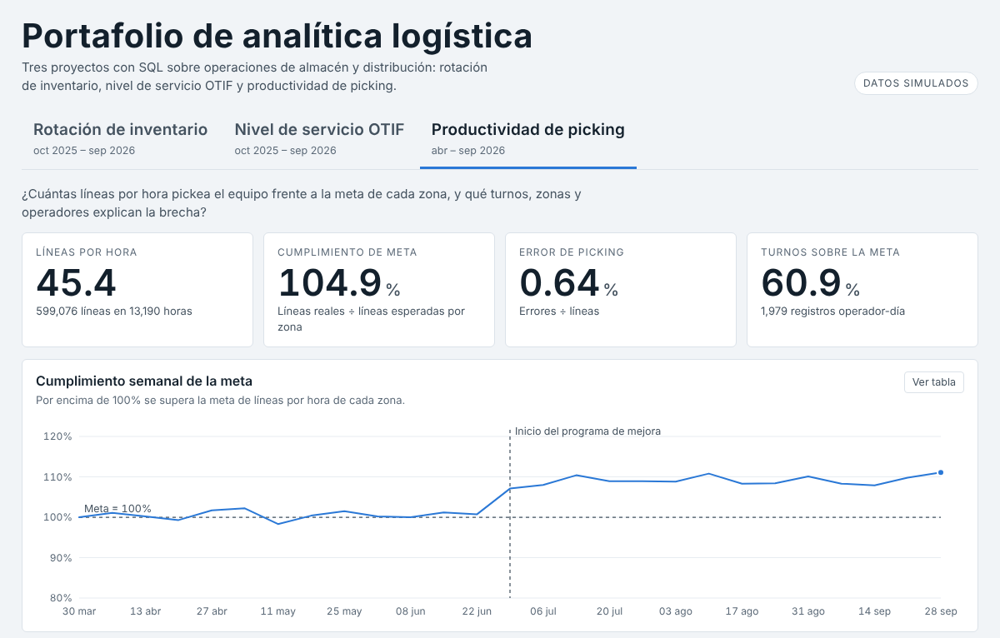

# Proyecto 3 · Productividad de picking



> Datos **simulados** (no provienen de ninguna empresa). Se generaron con errores de calidad a propósito.

## Pregunta de negocio
¿Cuántas líneas por hora pickea el equipo frente a la meta de cada zona, y qué turnos, zonas y operadores explican la brecha?

## Datos
| Archivo | Contenido |
|---|---|
| `data/picking.csv` | Registro por operador y día: zona, líneas, unidades, horas y errores (abr – sep 2026) |
| `data/operadores.csv` | 14 operadores con turno, antigüedad y zona principal |
| `data/metas.csv` | Meta de líneas por hora por zona |

## Limpieza (`sql/00_diagnostico.sql` y `sql/01_limpieza.sql`)
| Problema | Filas | Tratamiento |
|---|---|---|
| Filas totales en bruto | 2055 | Referencia |
| id_registro duplicado (filas sobrantes) | 25 | Se conserva la primera aparición |
| Fecha en formato dd/mm/yyyy | 82 | Se convierte a yyyy-mm-dd |
| Turno escrito de forma inconsistente | 58 | Se unifica a Mañana / Tarde / Noche |
| Horas vacías o en cero | 25 | Se excluyen: no se puede calcular líneas por hora |
| Horas atípicas (> 12 en un día) | 8 | Se excluyen: error de digitación probable (72 en lugar de 7.2) |
| Líneas vacías | 12 | Se excluyen |
| Líneas negativas | 6 | Se excluyen: podría ser una reversa y no un picking |
| Registros válidos para KPIs | 1979 | Base de los KPIs |

Detalle técnico: `UPPER` y `LOWER` de SQLite no convierten la Ñ, por eso el turno se normaliza por su primera letra.

## Métricas (`sql/02_kpis.sql`)
- **Líneas por hora** = suma de líneas ÷ suma de horas. Es un promedio ponderado: promediar los ratios diarios daría el mismo peso a un día de 3 horas que a uno de 8.
- **Cumplimiento de meta** = suma de líneas ÷ suma de (horas × meta de la zona).
- **Error de picking** = errores ÷ líneas.
- Cortes por mes, semana, turno, zona, día de la semana, antigüedad y operador (ranking con `RANK()`).

## Resultados
- **45.4 líneas por hora**, cumplimiento de meta **104.9%** y error de **0.64%**.
- Antes de julio 100.5%; desde julio 109.2%. La comparación no prueba causalidad porque también cambia la madurez del equipo.
- Turno noche: 85.5% frente a 111.6% del turno mañana.
- 5 de 14 operadores quedan bajo la meta. Con menos de 6 meses de antigüedad el cumplimiento es 84.9%.

## Cómo reproducirlo
```bash
python3 generar_datos.py
python3 run.py
```

## Power BI
Importa de `output/`: `picking_valido.csv` (hechos), `kpi_operador.csv` y `metas.csv`.

```dax
Líneas = SUM ( picking_valido[lineas] )
Horas = SUM ( picking_valido[horas] )
Líneas por Hora = DIVIDE ( [Líneas], [Horas] )
Líneas Esperadas = SUM ( picking_valido[lineas_esperadas] )
Cumplimiento Meta = DIVIDE ( [Líneas], [Líneas Esperadas] )
Error % = DIVIDE ( SUM ( picking_valido[errores] ), [Líneas] )
```
Cuida que `Líneas por Hora` sea una medida y no el promedio de la columna `lph`; así queda ponderada por horas. Visuales sugeridos: tarjetas, línea semanal de cumplimiento con constante de 100%, barras por turno, zona y operador, y matriz turno × día.

## Limitaciones
- Las metas por zona son supuestos del ejercicio.
- No hay datos de volumen de pedidos ni de tipo de SKU, que también explican la productividad.
